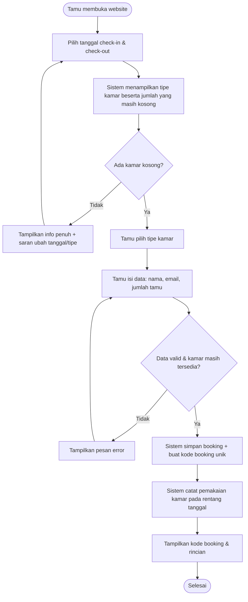
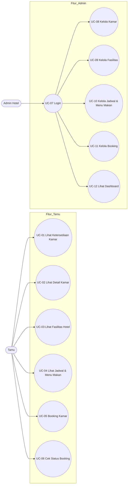
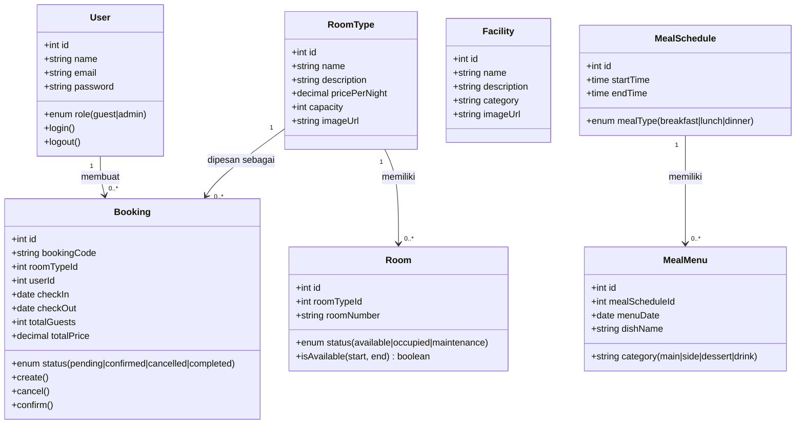
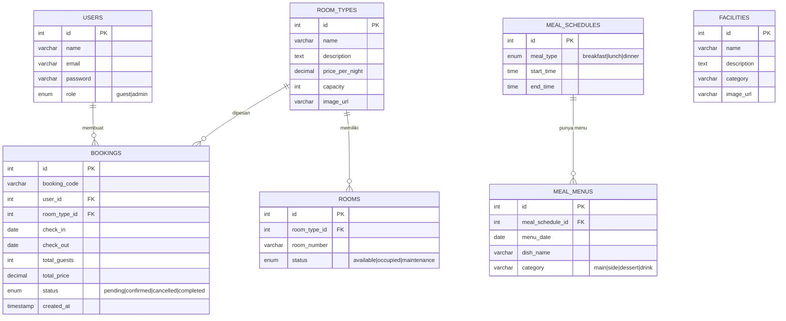

# Product Requirements Document (PRD)
## Website Booking Kamar Hotel

| | |
|---|---|
| **Nama Produk** | Hotel Booking System |
| **Versi Dokumen** | 1.0 |
| **Tanggal** | 19 Oktober 2026 |
| **Status** | Draft untuk Persetujuan |
| **Teknologi** | Next.js (Full-stack), Prisma ORM, PostgreSQL, Tailwind CSS, NextAuth.js |

---

## 1. Latar Belakang & Masalah (Problem Statement)

Calon tamu hotel mengalami **kesulitan besar** dalam tiga hal berikut sebelum dan saat melakukan booking:

1. **Kesusahan melihat kamar yang masih tersedia.** Ketika ingin membooking hotel, calon tamu tidak bisa dengan mudah mengetahui kamar mana yang masih kosong pada tanggal yang mereka inginkan. Informasi ketersediaan kamar tidak transparan dan sering kali harus ditanyakan langsung ke petugas hotel.

2. **Tidak mengetahui menu/lauk apa saja yang disajikan pada saat jam makan.** Calon tamu tidak mendapat informasi mengenai jadwal jam makan (pagi, siang, malam) dan lauk/menu apa saja yang disediakan pada setiap waktu makan, sehingga mereka sulit memperkirakan layanan makanan yang akan mereka terima.

3. **Kesusahan mencari tahu fasilitas apa saja yang disediakan hotel.** Tanpa kehadiran atau tanpa menemukan petugas hotel, calon tamu sulit mengetahui fasilitas yang tersedia (kolam renang, gym, restoran, spa, dll.).

**Dampak dari masalah ini:**
- Calon tamu berpotensi memilih hotel kompetitor yang lebih transparan.
- Beban kerja petugas front office meningkat karena harus menjawab pertanyaan yang sama berulang-ulang.
- Proses booking menjadi lambat dan berisiko terjadi *double booking* karena informasi stok kamar tidak akurat.

---

## 2. Tujuan Produk (Goals)

| Kode | Tujuan | Indikator Keberhasilan |
|---|---|---|
| G1 | Tamu dapat melihat ketersediaan kamar secara **real-time** berdasarkan tanggal check-in/check-out | Tamu tidak perlu bertanya ke petugas untuk mengetahui kamar kosong |
| G2 | Tamu dapat melihat **jadwal jam makan dan menu/lauk** yang disajikan | Informasi makanan tersedia tanpa harus bertanya |
| G3 | Tamu dapat melihat seluruh **fasilitas hotel** beserta deskripsi | Informasi fasilitas dapat diakses mandiri kapan saja |
| G4 | Tamu dapat **membooking kamar** secara mandiri dan mendapatkan kode booking | Proses booking selesai < 3 menit tanpa interaksi petugas |
| G5 | Admin hotel dapat **mengelola seluruh data** (kamar, fasilitas, jadwal makan, booking) | Admin tidak perlu mengubah data melalui database langsung |

**Non-Goals (di luar cakupan versi ini):**
- Pembayaran online/gateway pembayaran
- Integrasi channel manager (OTA seperti Traveloka, Booking.com)
- Aplikasi mobile native
- Program loyalitas tamu

---

## 3. Pengguna & Persona

### 3.1 Pengguna Utama
| Peran | Deskripsi |
|---|---|
| **Tamu (Guest)** | Calon penyewa kamar hotel yang ingin melihat ketersediaan kamar, fasilitas, jadwal makan, dan melakukan booking secara mandiri |
| **Admin Hotel** | Petugas/staff hotel yang bertugas mengelola data kamar, fasilitas, jadwal & menu makan, serta memproses booking |

### 3.2 Persona — Tamu
> **Budi, 32 tahun** — pebisnis yang sering bepergian. Sebelum booking hotel, Budi ingin langsung melihat kamar mana yang kosong di tanggal meeting-nya, apakah hotel punya gym, dan menu sarapan apa yang tersedia. Budi tidak punya waktu menelepon front office dan sering booking di luar jam kerja petugas.

### 3.3 Persona — Admin
> **Sari, 28 tahun** — staff front office. Sari kelelahan menjawab pertanyaan yang sama berulang kali: "Kamar masih ada nggak?", "Sarapannya apa aja?", "Ada kolam renang nggak?". Sari butuh satu tempat untuk meng-update data kamar, menu makan harian, dan daftar fasilitas.

---

## 4. User Stories & Fitur (MVP)

### 4.1 MVP Tamu (Guest)

| ID | User Story | Prioritas | Kriteria Penerimaan (Acceptance Criteria) |
|---|---|---|---|
| US-01 | Sebagai tamu, saya ingin memilih tanggal check-in dan check-out agar sistem menampilkan kamar yang masih kosong pada rentang tanggal tersebut | Must Have | - Sistem menampilkan daftar tipe kamar beserta **jumlah kamar kosong** per tipe <br>- Hanya kamar yang benar-benar tersedia yang ditampilkan <br>- Kamar yang sedang dipesan orang lain pada rentang tanggal yang sama **tidak dihitung sebagai kosong** |
| US-02 | Sebagai tamu, saya ingin melihat detail kamar (foto, harga, kapasitas, fasilitas kamar) | Must Have | - Setiap tipe kamar menampilkan harga per malam, kapasitas tamu, dan fasilitas di dalam kamar |
| US-03 | Sebagai tamu, saya ingin melihat daftar fasilitas hotel beserta deskripsi dan foto | Must Have | - Halaman fasilitas menampilkan seluruh fasilitas yang dikelola admin <br>- Setiap fasilitas punya nama, kategori, deskripsi, dan gambar |
| US-04 | Sebagai tamu, saya ingin melihat jam makan (pagi/siang/malam) dan lauk/menu apa saja yang disajikan pada tiap waktu makan | Must Have | - Sistem menampilkan jadwal waktu makan (jam mulai–selesai) <br>- Sistem menampilkan menu/lauk per waktu makan berdasarkan tanggal yang dipilih <br>- Menu dapat berbeda setiap hari |
| US-05 | Sebagai tamu, saya ingin membooking kamar dengan mengisi data diri dan memilih tanggal | Must Have | - Sistem validasi ketersediaan ulang sebelum menyimpan <br>- Booking berhasil tersimpan dengan **kode booking unik** <br>- Total harga dihitung otomatis: harga per malam × jumlah malam |
| US-06 | Sebagai tamu, saya ingin mengecek status booking saya menggunakan kode booking | Must Have | - Tamu dapat mencari booking berdasarkan kode booking <br>- Status booking ditampilkan: pending / confirmed / cancelled / completed |

### 4.2 MVP Admin

| ID | User Story | Prioritas | Kriteria Penerimaan |
|---|---|---|---|
| US-07 | Sebagai admin, saya ingin login agar hanya pihak berwenang yang bisa mengelola data | Must Have | - Login dengan email + password <br>- Password di-hash (bcrypt) <br>- Halaman admin terproteksi middleware |
| US-08 | Sebagai admin, saya ingin CRUD tipe kamar dan kamar | Must Have | - Admin dapat tambah/ubah/hapus tipe kamar (nama, harga, kapasitas, deskripsi, foto) <br>- Admin dapat tambah/ubah status kamar individual (tersedia / terisi / maintenance) |
| US-09 | Sebagai admin, saya ingin CRUD fasilitas hotel | Must Have | - Admin dapat kelola daftar fasilitas lengkap dengan kategori, deskripsi, dan foto |
| US-10 | Sebagai admin, saya ingin CRUD jadwal makan dan menu/lauk per tanggal | Must Have | - Admin dapat atur jam makan (breakfast, lunch, dinner) <br>- Admin dapat input menu/lauk per jadwal dan per tanggal |
| US-11 | Sebagai admin, saya ingin mengelola booking (konfirmasi, batalkan, selesaikan) | Must Have | - Admin dapat mengubah status booking <br>- Pembatalan booking **mengembalikan ketersediaan kamar** secara otomatis |
| US-12 | Sebagai admin, saya ingin melihat ringkasan okupansi kamar | Should Have | - Dashboard menampilkan jumlah kamar terisi, kosong, dan booking hari ini |

### 4.3 Backlog (Pasca-MVP)

| Fitur | Prioritas |
|---|---|
| Pembayaran online (Midtrans/Xendit) | Should Have |
| Notifikasi email/WhatsApp otomatis | Should Have |
| Ulasan & rating tamu | Could Have |
| Promo/diskon musiman | Could Have |
| Multi-bahasa (ID/EN) | Could Have |

---

## 5. Alur Pengguna (User Flow)

### 5.1 Flowchart Booking Kamar



### 5.2 Mekanisme Ketersediaan Kamar (Kunci Sistem)

Ketersediaan kamar **dihitung dinamis**, bukan berupa angka stok statis:

```
Kamar Kosong (tipe X, rentang tanggal A–B) =
      total kamar tipe X
    − jumlah booking tipe X berstatus pending/confirmed
      yang tanggalnya tumpang-tindih (overlap) dengan A–B

Kondisi overlap: booking.check_in < B  AND  booking.check_out > A
```

**Mengapa ini penting:** masalah utama yang diselesaikan produk ini adalah informasi kamar tersedia yang tidak akurat. Perhitungan dinamis memastikan tamu tidak pernah melihat kamar "kosong" padahal sudah dipesan orang lain.

---

## 6. Use Case Diagram



**Skenario utama UC-05 (Booking Kamar):**

| # | Aktor (Tamu) | Sistem |
|---|---|---|
| 1 | Membuka halaman ketersediaan, memilih tanggal | Menampilkan kamar kosong per tipe |
| 3 | Memilih tipe kamar, mengisi nama/email/jumlah tamu | Memvalidasi data dan ketersediaan ulang |
| 5 | Mengonfirmasi booking | Menyimpan booking, menghitung total harga, menampilkan kode booking |

**Skenario alternatif:** kamar penuh → sistem menolak dan menyarankan tipe/tanggal lain; data tidak valid → sistem meminta perbaikan.

---

## 7. Arsitektur Sistem

### 7.1 Stack Teknologi

| Lapisan | Teknologi | Kegunaan |
|---|---|---|
| Frontend | Next.js App Router + React + Tailwind CSS | Halaman publik (tamu) dan panel admin |
| Backend | Next.js Route Handlers (API Routes) | REST API terpadu dalam satu codebase |
| Pola arsitektur | **MVC** | Model (Prisma), View (Pages/Components), Controller (Route Handlers + Service) |
| Database | PostgreSQL (atau MySQL) + Prisma ORM | Penyimpanan data transaksional |
| Autentikasi | NextAuth.js (Auth.js) + bcrypt | Login tamu & admin berbasis JWT |
| Validasi | Zod | Validasi input API |
| State management | React Hooks / Zustand | State UI |
| Deployment | Vercel + Supabase/Railway | Hosting frontend & database |

### 7.2 Struktur Folder MVC

```
hotel-booking/
├── prisma/
│   └── schema.prisma              # MODEL (definisi data)
├── src/
│   ├── app/
│   │   ├── (guest)/               # VIEW — sisi tamu
│   │   │   ├── page.tsx                   # Beranda
│   │   │   ├── rooms/page.tsx             # Ketersediaan & detail kamar
│   │   │   ├── facilities/page.tsx        # Fasilitas hotel
│   │   │   ├── meals/page.tsx             # Jadwal & menu makan
│   │   │   └── booking/page.tsx           # Form booking
│   │   ├── (admin)/               # VIEW — panel admin
│   │   │   └── admin/
│   │   │       ├── rooms/…                # Kelola kamar
│   │   │       ├── facilities/…           # Kelola fasilitas
│   │   │       ├── meals/…                # Kelola jadwal & menu
│   │   │       └── bookings/…             # Kelola booking
│   │   └── api/                   # CONTROLLER (Route Handlers)
│   │       ├── availability/route.ts      # GET kamar kosong
│   │       ├── bookings/route.ts          # POST/GET booking
│   │       ├── facilities/route.ts        # GET fasilitas
│   │       ├── meals/route.ts             # GET jadwal + menu makan
│   │       └── admin/…                    # Endpoint khusus admin
│   ├── controllers/               # CONTROLLER layer
│   ├── services/                  # Business logic
│   │   ├── booking.service.ts
│   │   ├── availability.service.ts
│   │   └── meal.service.ts
│   ├── models/                    # Akses data (wrapper Prisma)
│   │   ├── booking.model.ts
│   │   ├── room.model.ts
│   │   └── meal.model.ts
│   ├── lib/
│   │   ├── prisma.ts
│   │   └── auth.ts
│   └── components/                # Komponen UI (View)
│       ├── RoomCard.tsx
│       ├── MealCard.tsx
│       └── BookingForm.tsx
└── middleware.ts                  # Proteksi route admin
```

**Alur request MVC:**
```
Browser → View (page.tsx) → API Route (Controller)
        → Service → Model (Prisma) → Database
        → Response JSON → Render ulang View
```

### 7.3 API Endpoint

| Method | Endpoint | Aktor | Fungsi |
|---|---|---|---|
| GET | `/api/availability?checkIn=&checkOut=` | Tamu | Kamar kosong per tipe (fitur inti) |
| GET | `/api/room-types/:id` | Tamu | Detail satu tipe kamar |
| GET | `/api/facilities` | Tamu | Daftar fasilitas hotel |
| GET | `/api/meals?date=` | Tamu | Jadwal makan + lauk per tanggal |
| POST | `/api/bookings` | Tamu | Buat booking baru |
| GET | `/api/bookings/:code` | Tamu | Cek status booking |
| POST | `/api/admin/room-types` | Admin | Tambah/ubah tipe kamar |
| PUT | `/api/admin/rooms/:id` | Admin | Ubah status kamar |
| POST/PUT/DELETE | `/api/admin/facilities` | Admin | Kelola fasilitas |
| POST/PUT/DELETE | `/api/admin/meals` | Admin | Kelola jadwal & menu |
| PUT | `/api/admin/bookings/:id` | Admin | Ubah status booking |

---

## 8. Class Diagram



---

## 9. Desain Database

### 9.1 ERD



### 9.2 Skema Prisma (Model)

```prisma
model User {
  id        Int       @id @default(autoincrement())
  name      String
  email     String    @unique
  password  String
  role      Role      @default(GUEST)
  bookings  Booking[]
}

enum Role { GUEST ADMIN }

model RoomType {
  id            Int       @id @default(autoincrement())
  name          String
  description   String?
  pricePerNight Decimal
  capacity      Int
  imageUrl      String?
  rooms         Room[]
  bookings      Booking[]
}

model Room {
  id         Int         @id @default(autoincrement())
  roomTypeId Int
  roomNumber String      @unique
  status     RoomStatus  @default(AVAILABLE)
  roomType   RoomType    @relation(fields: [roomTypeId], references: [id])
}

enum RoomStatus { AVAILABLE OCCUPIED MAINTENANCE }

model Facility {
  id          Int     @id @default(autoincrement())
  name        String
  description String?
  category    String
  imageUrl    String?
}

model MealSchedule {
  id        Int         @id @default(autoincrement())
  mealType  MealType
  startTime DateTime    @db.Time
  endTime   DateTime    @db.Time
  menus     MealMenu[]
}

enum MealType { BREAKFAST LUNCH DINNER }

model MealMenu {
  id             Int          @id @default(autoincrement())
  mealScheduleId Int
  menuDate       DateTime     @db.Date
  dishName       String
  category       String
  mealSchedule   MealSchedule @relation(fields: [mealScheduleId], references: [id])
}

model Booking {
  id          Int           @id @default(autoincrement())
  bookingCode String        @unique
  userId      Int
  roomTypeId  Int
  checkIn     DateTime      @db.Date
  checkOut    DateTime      @db.Date
  totalGuests Int
  totalPrice  Decimal
  status      BookingStatus @default(PENDING)
  createdAt   DateTime      @default(now())
  user        User          @relation(fields: [userId], references: [id])
  roomType    RoomType      @relation(fields: [roomTypeId], references: [id])

  @@index([roomTypeId, checkIn, checkOut])
}

enum BookingStatus { PENDING CONFIRMED CANCELLED COMPLETED }
```

---

## 10. Kebutuhan Non-Fungsional

| Aspek | Kebutuhan |
|---|---|
| **Performa** | Halaman ketersediaan kamar termuat < 2 detik; query ketersediaan < 500 ms |
| **Ketersediaan** | Uptime 99,5%; informasi ketersediaan selalu konsisten dengan data booking |
| **Keamanan** | Password di-hash bcrypt; route admin terproteksi; validasi semua input dengan Zod; proteksi SQL injection via Prisma ORM |
| **Kompatibilitas** | Responsif di mobile, tablet, dan desktop |
| **Skalabilitas** | Struktur modular (service layer) agar mudah menambah fitur pasca-MVP |
| **Bahasa** | Bahasa Indonesia (opsi multi-bahasa di backlog) |

---

## 11. Metrik Keberhasilan (Success Metrics)

| Metrik | Target 3 bulan pasca-launch |
|---|---|
| % booking selesai tanpa kontak petugas | > 70% |
| Pengurangan pertanyaan berulang ke front office | > 50% |
| Rasio pengunjung → booking (konversi) | > 5% |
| Waktu rata-rata menyelesaikan booking | < 3 menit |
| Tingkat kesalahan ketersediaan (kamar terlihat kosong padahal penuh) | 0% |

---

## 12. Risiko & Mitigasi

| Risiko | Dampak | Mitigasi |
|---|---|---|
| Dua tamu booking kamar terakhir bersamaan | Double booking | Validasi ulang ketersediaan di transaction database saat simpan booking |
| Admin lupa update menu makan | Informasi makanan menyesatkan | Dashboard admin diberi pengingat; tampilkan tanggal update terakhir di halaman tamu |
| Data kamar tidak sinkron dengan kenyataan | Tamu kecewa | Admin wajib update status kamar harian; dashboard okupansi |
| Kenaikan trafik saat musim libur | Website lambat | Index database pada kolom booking (sudah ada di schema), caching halaman publik |

---

## 13. Roadmap Rilis

| Fase | Lingkup | Estimasi |
|---|---|---|
| **Fase 1 — MVP** | US-01 s.d. US-11 (ketersediaan kamar, fasilitas, jadwal makan, booking, panel admin dasar) | 6–8 minggu |
| **Fase 2** | Dashboard okupansi (US-12), pembayaran online, notifikasi email/WhatsApp | 4 minggu |
| **Fase 3** | Ulasan tamu, promo, multi-bahasa, aplikasi mobile (PWA) | 4+ minggu |

---

## 14. Lampiran: Definisi Istilah

| Istilah | Definisi |
|---|---|
| **Ketersediaan kamar** | Jumlah kamar yang benar-benar dapat dipesan pada rentang tanggal tertentu, dihitung dinamis dari data booking |
| **Overlap tanggal** | Dua rentang tanggal saling tumpang-tindih; kondisi `check_in < tanggal_akhir AND check_out > tanggal_awal` |
| **Kode booking** | Kode unik yang dihasilkan sistem untuk identifikasi booking tamu |
| **MVP** | Minimum Viable Product — fitur paling inti agar produk layak diluncurkan |
| **MVC** | Model–View–Controller — pola pemisahan data, tampilan, dan logika permintaan |
